# Docker

Guia de instalação do Docker e dos comandos essenciais do dia a dia, com Windows, macOS e Linux.

---

## Conteúdo

- [Como o Docker funciona](#como-o-docker-funciona)
- [Pré-requisitos](#pré-requisitos)
- [1. Instalação no Windows e no macOS](#1-instalação-no-windows-e-no-macos)
- [2. Instalação no Linux (Ubuntu/Debian)](#2-instalação-no-linux-ubuntudebian)
- [3. Verificação](#3-verificação)
- [Comandos do dia a dia](#comandos-do-dia-a-dia)
- [Docker Compose](#docker-compose)
- [Limpeza](#limpeza)
- [Recursos adicionais](#recursos-adicionais)

---

## Como o Docker funciona

| Peça | O que é | Comando |
|---|---|---|
| **Dockerfile** | A receita: sistema base, dependências e comando de início | — |
| **Imagem** | O pacote pronto e imutável gerado a partir da receita | `docker build` |
| **Container** | Uma imagem em execução, isolada das outras | `docker run` |
| **Registry** | Onde as imagens ficam guardadas e são compartilhadas (Docker Hub) | `docker pull` / `docker push` |

---

## Pré-requisitos

- **Windows**: Windows 10 ou 11 com WSL 2 habilitado.
- **macOS**: chip Intel ou Apple Silicon (M1 em diante).
- **Linux**: distribuição de 64 bits (Ubuntu, Debian, Fedora etc.).

---

## 1. Instalação no Windows e no macOS

A forma mais simples é o **Docker Desktop**.

1. Baixe o instalador em [docker.com/products/docker-desktop](https://www.docker.com/products/docker-desktop/).
2. Execute o arquivo e siga o assistente.
3. No Windows, deixe marcada a opção **Use WSL 2 instead of Hyper-V**.
4. Abra o Docker Desktop ao final da instalação e espere o ícone indicar que o motor está rodando.

---

## 2. Instalação no Linux (Ubuntu/Debian)

Comandos da [documentação oficial](https://docs.docker.com/engine/install/ubuntu/) para instalar o Docker Engine pelo repositório da Docker:

```bash
# Chave GPG oficial da Docker
sudo apt update
sudo apt install ca-certificates curl
sudo install -m 0755 -d /etc/apt/keyrings
sudo curl -fsSL https://download.docker.com/linux/ubuntu/gpg -o /etc/apt/keyrings/docker.asc
sudo chmod a+r /etc/apt/keyrings/docker.asc

# Repositório da Docker nas fontes do apt
sudo tee /etc/apt/sources.list.d/docker.sources <<EOF
Types: deb
URIs: https://download.docker.com/linux/ubuntu
Suites: $(. /etc/os-release && echo "${UBUNTU_CODENAME:-$VERSION_CODENAME}")
Components: stable
Architectures: $(dpkg --print-architecture)
Signed-By: /etc/apt/keyrings/docker.asc
EOF
sudo apt update

# Docker Engine, CLI, Buildx e Compose
sudo apt install docker-ce docker-ce-cli containerd.io docker-buildx-plugin docker-compose-plugin
```

**No Debian**, troque `linux/ubuntu` por `linux/debian` nas duas URLs; o resto é igual.

**Atalho**: o script oficial faz tudo isso de uma vez. É prático em servidores de teste, e a Docker não o recomenda para produção:

```bash
curl -fsSL https://get.docker.com | sudo sh
```

### Rodar o Docker sem `sudo` (opcional)

```bash
sudo usermod -aG docker $USER
# Saia e entre de novo na sessão (ou reinicie) para valer
```

Quem está no grupo `docker` tem poder equivalente ao de root na máquina, então adicione só usuários de confiança.

---

## 3. Verificação

No terminal (ou no PowerShell):

```bash
docker --version
docker compose version
docker run hello-world
```

Se aparecer a mensagem **"Hello from Docker!"**, a instalação está funcionando.

---

## Comandos do dia a dia

```bash
docker ps                         # Containers em execução
docker ps -a                      # Todos, inclusive os parados
docker images                     # Imagens baixadas
docker pull nginx                 # Baixa uma imagem do Docker Hub
docker run -d -p 8080:80 --name web nginx   # Sobe em segundo plano, porta 8080 do host → 80 do container
docker logs -f web                # Acompanha os logs
docker exec -it web sh            # Abre um terminal dentro do container
docker stop web                   # Para o container
docker rm web                     # Remove o container parado
docker build -t meu-app .         # Gera uma imagem a partir do Dockerfile da pasta
```

---

## Docker Compose

O Compose sobe vários containers juntos a partir de um arquivo `compose.yaml` (ou `docker-compose.yml`), com as redes e os volumes que eles compartilham.

```bash
docker compose up -d              # Sobe tudo em segundo plano
docker compose up -d --build      # Reconstrói as imagens antes de subir
docker compose ps                 # Estado dos serviços
docker compose logs -f            # Logs de todos os serviços
docker compose down               # Para e remove os containers (os volumes ficam)
```

Use `docker compose`, com espaço. O antigo `docker-compose`, com hífen, é a versão 1, que foi descontinuada.

---

## Limpeza

```bash
docker system df                  # Quanto espaço o Docker está ocupando
docker system prune               # Remove containers parados, redes sem uso e imagens órfãs
docker image prune -a             # Remove todas as imagens que nenhum container usa
```

Os volumes só são apagados com `docker volume prune` ou `docker compose down -v`. Faça isso apenas se tiver certeza, porque é onde ficam os dados dos bancos.

---

## Recursos adicionais

- [Documentação oficial do Docker](https://docs.docker.com/)
- [Instalação no Ubuntu](https://docs.docker.com/engine/install/ubuntu/) · [no Debian](https://docs.docker.com/engine/install/debian/)
- [Passos pós-instalação no Linux](https://docs.docker.com/engine/install/linux-postinstall/)
- [Docker Hub](https://hub.docker.com/)
